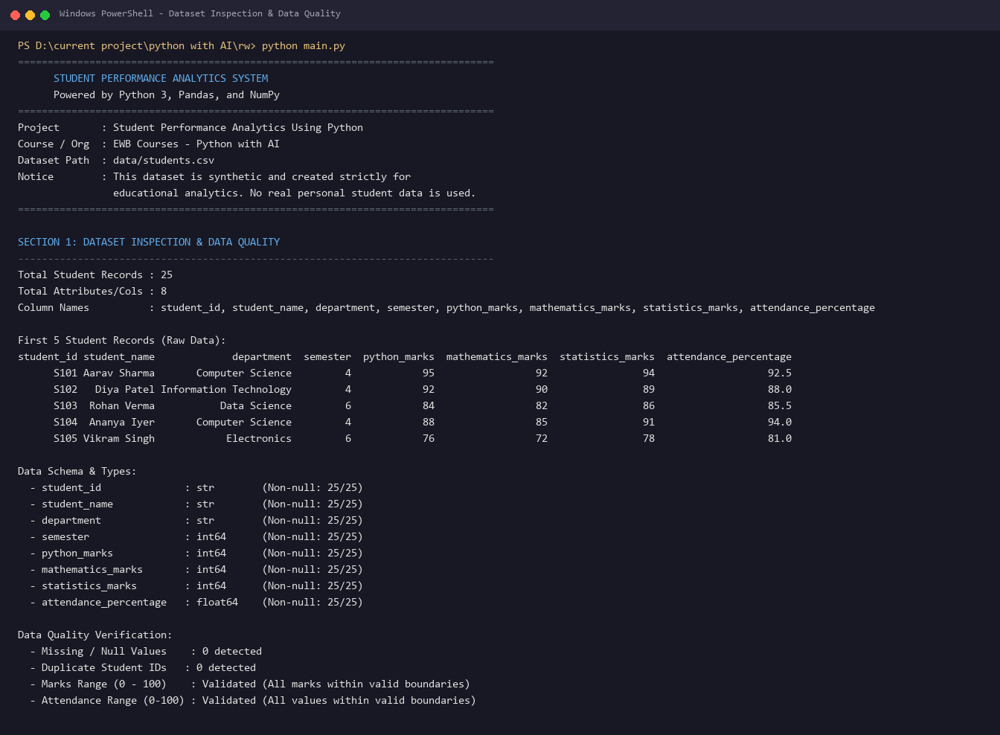
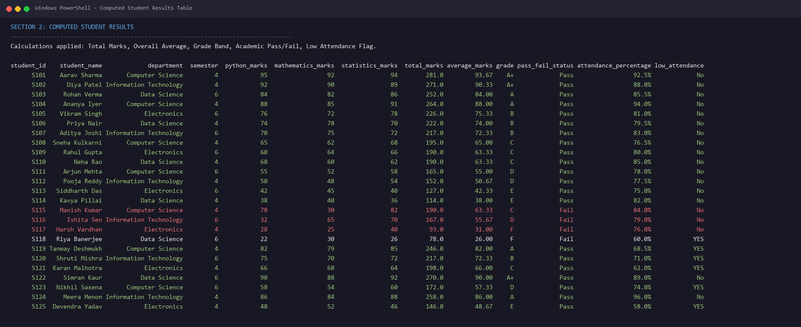
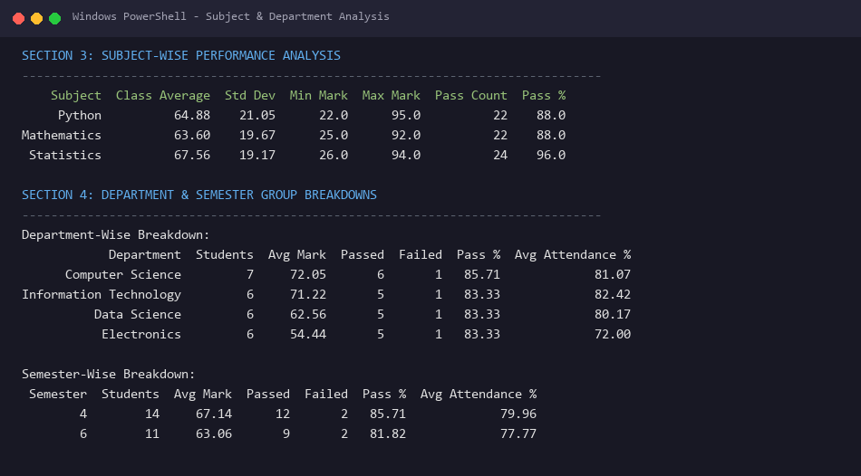
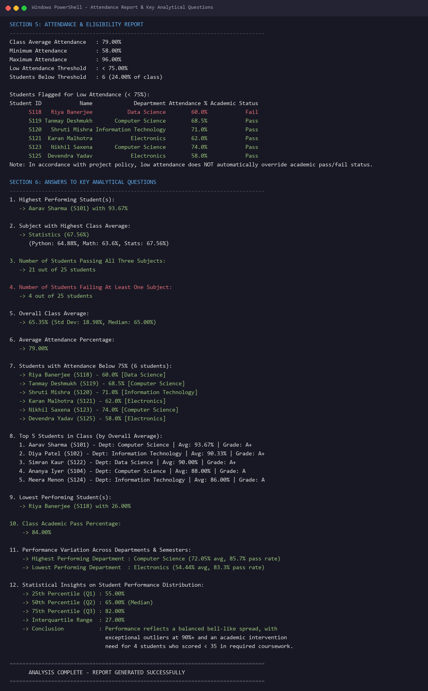
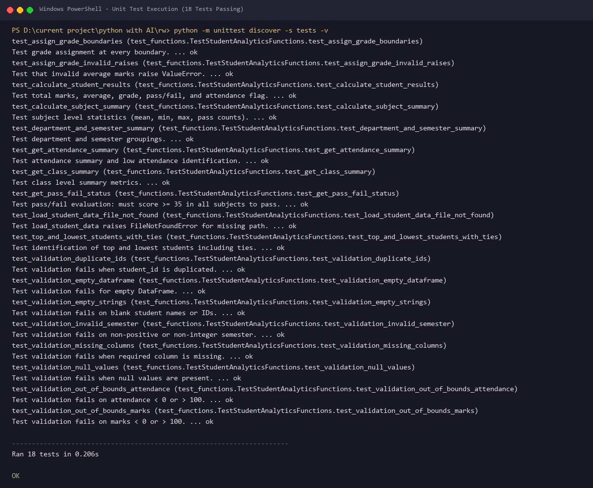

# Project Documentation: Student Performance Analytics Using Python

---

## 1. Project Title

**Project Name:** Student Performance Analytics Using Python  
**Course / Programme:** EWB Courses – Python with AI  
**Repository Name:** `python-with-ai-internship-mini-project`  

### Student Academic Details
> *Fill in your academic and course submission details below before final submission:*

- **Student Name:** Rajeshwari
- **Course / Programme:** EWB Courses – Python with AI
- **Registration / Roll Number:** `[Registration / Roll Number]`
- **Department / Specialization:** `[Department / Specialization]`
- **Institution / University:** `[Institution / University]`
- **Submission Date:** October 2026

---

## 2. Objective

Educational institutions routinely handle large volumes of student academic data, including subject-level examination scores, continuous evaluations, and attendance tracking. Manually managing and assessing these records across departments and semesters is error-prone, labor-intensive, and fails to provide rapid actionable feedback for academic interventions.

The objective of this project is to develop an automated, reproducible, and robust command-line data analytics system using **Python**, **Pandas**, and **NumPy** that:
1. Loads, verifies, and validates student performance datasets from standard CSV files.
2. Applies standard educational grading band rules and academic pass/fail criteria.
3. Tracks student attendance eligibility independently of academic subject performance.
4. Leverages Pandas DataFrame operations and NumPy statistical calculations to perform multi-dimensional aggregations across subjects, departments, and semesters.
5. Provides immediate answers to 12 core institutional analytical questions, identifying both high achievers and students needing remediation.
6. Guarantees software reliability and calculation correctness through a comprehensive automated unit test suite.

---

## 3. Technologies Used

This project relies strictly on established, high-performance Python ecosystem tools without unnecessary external APIs or heavy web frameworks:

1. **Python 3.11 Standard Library:**
   - `pathlib.Path`: For OS-independent, safe filesystem path resolution relative to script source locations.
   - `unittest`: Built-in framework for automated unit testing and edge case verification.
   - `sys`: Clean exit handling and standard stream management.
   - `typing`: Type annotations (`Dict`, `List`, `Union`, `Any`) for self-documenting, maintainable code.

2. **Pandas (v3.0.6):**
   - Data loading and structured tabular representation via `DataFrame`.
   - Data validation, null detection, string filtering, and duplicate identification.
   - Column-level transformations, sorting (`sort_values`), and grouping (`groupby`).

3. **NumPy (v2.4.6):**
   - High-performance vector calculations: `np.sum()`, `np.mean()`, `np.std(ddof=1)`.
   - Boundary checks: `np.min()`, `np.max()`.
   - Distribution analytics: `np.percentile()` for quartiles ($Q_1, Q_2, Q_3$).

4. **CSV (Comma-Separated Values):**
   - Industry-standard, portable tabular data exchange format.

---

## 4. Dataset Description

The dataset is stored in `data/students.csv`. It contains **25 records** with 8 attributes per student.

### Dataset Metadata & Disclaimer
- **Dataset File:** `data/students.csv`
- **Total Records:** 25
- **Synthetic Data Disclaimer:** The dataset is entirely synthetic and was created solely for educational purposes. All student names, ID numbers, marks, and attendance values are fictional. No actual personally identifiable information (PII) is included or referenced.

### Data Schema Table

| Column Name | Data Type | Permitted Range | Description |
|---|---|---|---|
| `student_id` | String / Object | Non-empty, unique | Unique identifier assigned to each student (e.g. S101, S102). |
| `student_name` | String / Object | Non-empty text | Fictional student full name. |
| `department` | String / Object | Non-empty text | Academic department (Computer Science, Information Technology, Data Science, Electronics). |
| `semester` | Integer | Positive integer ($\ge 1$) | Current academic semester (e.g. 4 or 6). |
| `python_marks` | Float / Numeric | 0.0 – 100.0 | Marks scored in Python Programming. |
| `mathematics_marks` | Float / Numeric | 0.0 – 100.0 | Marks scored in Applied Mathematics. |
| `statistics_marks` | Float / Numeric | 0.0 – 100.0 | Marks scored in Applied Statistics. |
| `attendance_percentage` | Float / Numeric | 0.0 – 100.0 | Overall course attendance recorded in percentage. |

---

## 5. Implementation

The system is implemented across modular, decoupled files to ensure clean separation of concerns:

```
├── main.py                     # Execution orchestration and CLI output presentation
├── functions.py                # Reusable analytical algorithms, calculations, and validators
├── data/students.csv           # Validated data file
└── tests/test_functions.py     # Automated unit test suite
```

### Step-by-Step Workflow

1. **Path-Safe Dataset Loading (`functions.load_student_data`):**
   - Resolves file paths using `Path(__file__).resolve().parent / "data" / "students.csv"`. This ensures the script executes correctly whether invoked from the repository root, a subdirectory, or an IDE terminal.
   - Verifies file existence and rejects zero-byte empty files with informative errors.

2. **Data Integrity Validation (`functions.validate_student_data`):**
   - Verifies the presence of all 8 mandatory columns.
   - Detects nulls, `NaN` values, or blank whitespace strings.
   - Enforces uniqueness of `student_id`.
   - Validates that semester is a positive integer.
   - Ensures all marks and attendance numbers fall strictly between 0 and 100.

3. **Academic Results Computation (`functions.calculate_student_results`):**
   - Creates a copy of the DataFrame to prevent accidental mutation.
   - Computes total marks via NumPy vector summation: `np.sum(subject_matrix, axis=1)`.
   - Computes student average percentage: `np.mean(subject_matrix, axis=1)`.
   - Maps each student's average to a project-defined letter grade using `assign_grade()`.
   - Applies academic pass/fail criteria via `get_pass_fail_status()`.
   - Evaluates attendance eligibility: `low_attendance = attendance < 75.0`.

4. **Grading & Pass/Fail Policy Logic:**
   - **Pass/Fail Rule:** A subject is passed when mark $\ge 35$. A student passes overall only if all 3 subjects $\ge 35$.
   - **Grade Bands:**
     - 90% – 100%: `A+`
     - 80% – <90%: `A`
     - 70% – <80%: `B`
     - 60% – <70%: `C`
     - 50% – <60%: `D`
     - 35% – <50%: `E`
     - Below 35%: `F`
   - **Attendance Policy:** Attendance $< 75\%$ flags the student for institutional attendance intervention, but does not alter academic grades.

5. **Multi-Dimensional Grouping & Aggregations:**
   - **Subject Summary (`functions.calculate_subject_summary`):** Computes mean, sample standard deviation (`ddof=1`), min, max, and pass rates for Python, Mathematics, and Statistics.
   - **Department Summary (`functions.get_department_summary`):** Groups by department to compare student count, average marks, and departmental pass rates.
   - **Semester Summary (`functions.get_semester_summary`):** Groups by semester to assess progression trends.
   - **Attendance Summary (`functions.get_attendance_summary`):** Identifies students with low attendance.

6. **Automated Report Generation (`main.py`):**
   - Presents a structured terminal interface displaying tabular summaries, statistical distributions, and direct answers to all 12 institutional analytical questions.

---

## 6. Key Features

- **End-to-End Pipeline:** From raw CSV ingestion to multi-level reporting in one command.
- **Strict Data Validation:** Comprehensive protection against missing, corrupt, duplicate, or out-of-bound records.
- **Pure Functional Design:** Reusable calculation functions that avoid side effects and preserve raw input DataFrames.
- **NumPy & Pandas Synergy:** Leverages Pandas for structured data manipulation and NumPy for fast mathematical operations.
- **Granular Pass/Fail Logic:** Properly distinguishes individual subject failures from overall percentage averages.
- **Independent Attendance Tracking:** Prevents conflation of attendance discipline with academic aptitude while still flagging at-risk students.
- **Comprehensive Test Coverage:** 18 dedicated unit tests testing normal operations, boundary values, and deliberate corruption errors.

---

## 7. Output / Screenshots

### Actual Output Screenshots


*Figure 1: Program Banner, Schema Inspection, and Data Quality Checks.*


*Figure 2: Complete Student Results Table showing Totals, Averages, Grades, and Pass/Fail Status.*


*Figure 3: Subject-wise Performance, Department Breakdown, and Semester Analysis.*


*Figure 4: Attendance Report and Answers to the 12 Analytical Questions.*


*Figure 5: Verification of all 18 Unit Tests Passing with OK status.*


### Verified Terminal Output Excerpt

Below is the verified text output generated by `python main.py`:

```text
================================================================================
      STUDENT PERFORMANCE ANALYTICS SYSTEM
      Powered by Python 3, Pandas, and NumPy
================================================================================
Project       : Student Performance Analytics Using Python
Course / Org  : EWB Courses - Python with AI
Dataset Path  : data/students.csv
Notice        : This dataset is synthetic and created strictly for
                educational analytics. No real personal student data is used.
================================================================================

SECTION 3: SUBJECT-WISE PERFORMANCE ANALYSIS
--------------------------------------------------------------------------------
    Subject  Class Average  Std Dev  Min Mark  Max Mark  Pass Count  Pass %
     Python          64.88    21.05      22.0      95.0          22    88.0
Mathematics          63.60    19.67      25.0      92.0          22    88.0
 Statistics          67.56    19.17      26.0      94.0          24    96.0

SECTION 4: DEPARTMENT & SEMESTER GROUP BREAKDOWNS
--------------------------------------------------------------------------------
Department-Wise Breakdown:
            Department  Students  Avg Mark  Passed  Failed  Pass %  Avg Attendance %
      Computer Science         7     72.05       6       1   85.71             81.07
Information Technology         6     71.22       5       1   83.33             82.42
          Data Science         6     62.56       5       1   83.33             80.17
           Electronics         6     54.44       5       1   83.33             72.00

Semester-Wise Breakdown:
 Semester  Students  Avg Mark  Passed  Failed  Pass %  Avg Attendance %
        4        14     67.14      12       2   85.71             79.96
        6        11     63.06       9       2   81.82             77.77
```

---

## 8. Final Outcome

The completed program answers all 12 key analytical questions with actual figures computed from the dataset:

| # | Analytical Question | Computed Result / Finding |
|---|---|---|
| 1 | **Highest Performing Student(s)** | **Aarav Sharma** (`S101`), Computer Science, Overall Average: **93.67%** (Grade A+) |
| 2 | **Subject with Highest Class Average** | **Statistics** with a class average of **67.56%** (Python: 64.88%, Math: 63.60%) |
| 3 | **Students Passing All Three Subjects** | **21 out of 25 students** |
| 4 | **Students Failing At Least One Subject** | **4 out of 25 students** (`S115`, `S116`, `S117`, `S118`) |
| 5 | **Overall Class Average** | **65.35%** (Standard Deviation: 18.98%, Median: 65.00%) |
| 6 | **Average Attendance Percentage** | **79.00%** (Min: 58.00%, Max: 96.00%) |
| 7 | **Students with Attendance Below 75%** | **6 students** (`S118` [60.0%], `S119` [68.5%], `S120` [71.0%], `S121` [62.0%], `S123` [74.0%], `S125` [58.0%]) |
| 8 | **Top 5 Students by Average** | 1. Aarav Sharma (93.67%, A+)<br>2. Diya Patel (90.33%, A+)<br>3. Simran Kaur (90.00%, A+)<br>4. Ananya Iyer (88.00%, A)<br>5. Meera Menon (86.00%, A) |
| 9 | **Lowest Performing Student(s)** | **Riya Banerjee** (`S118`), Data Science, Overall Average: **26.00%** (Grade F) |
| 10 | **Class Academic Pass Percentage** | **84.00%** |
| 11 | **Department Performance Variation** | Highest: **Computer Science** (72.05% avg, 85.71% pass rate)<br>Lowest: **Electronics** (54.44% avg, 83.33% pass rate) |
| 12 | **Statistical Distribution Insights** | $Q_1 = 55.00\%$, Median = $65.00\%$, $Q_3 = 82.00\%$, IQR = $27.00\%$. The marks reflect a healthy distribution across tiers with 4 clear targets for academic remediation. |

---

## 9. Challenges and Learning

### Engineering Challenges Solved
1. **Dynamic File Path Resolution:**
   - *Problem:* Running Python scripts from different terminal working directories often causes `FileNotFoundError` when relative paths like `data/students.csv` are used.
   - *Solution:* Implemented `Path(__file__).resolve().parent / "data" / "students.csv"` in both `main.py` and `tests/test_functions.py` to ensure consistent resolution regardless of current working directory.
2. **Decoupling Grade Calculations from Pass/Fail Status:**
   - *Problem:* A student could score 78 in Python, 30 in Mathematics, and 82 in Statistics. Their average is 63.33% (Grade C), yet they failed Mathematics.
   - *Solution:* Separated the percentage grade band mapping (`assign_grade`) from the academic pass criterion (`get_pass_fail_status`). Student `S115` correctly receives Grade C with a `Fail` status, maintaining institutional integrity.
3. **Handling Tied Top & Lowest Performers:**
   - *Problem:* Simple `.head(1)` slices fail when two students share the highest mark.
   - *Solution:* Implemented boolean indexing (`df[df['average_marks'] == max_avg]`) in `get_highest_students()` and `get_lowest_students()` to return all tied candidates.
4. **Non-Destructive Operations:**
   - *Problem:* Applying calculations directly onto incoming DataFrames can mutate state unexpectedly during testing or subsequent processing.
   - *Solution:* Enforced `results = df.copy()` before appending computed columns, adhering to clean functional programming practices.

### Personal Reflection
> *Student Note: Add your own personal reflections here before final submission (e.g., what you learned about Pandas indexing, vectorization versus loops, and debugging test cases):*
> - *[Example: I gained practical experience handling edge cases in CSV data, writing automated unit tests using `unittest`, and utilizing Pandas `groupby` for academic reporting.]*

---

## 10. GitHub Repository

### Repository Link
**`https://github.com/rajeshwari229080/python-with-ai-internship-mini-project`**

### Steps to Publish Your Project to GitHub

1. **Initialize Git and Stage Project Files:**
   ```powershell
   git init
   git add .
   git commit -m "feat: complete student performance analytics project"
   ```
2. **Set Main Branch and Link Remote Repository:**
   ```powershell
   git branch -M main
   git remote add origin https://github.com/rajeshwari229080/python-with-ai-internship-mini-project.git
   ```
3. **Push Code to GitHub:**
   ```powershell
   git push -u origin main
   ```
4. **Ensure Repository is Public:**
   - Navigate to **Settings** $\rightarrow$ **General** $\rightarrow$ **Danger Zone** on GitHub.
   - Verify repository visibility is set to **Public** so instructors and reviewers can view your code.
5. **Submit to EWB Form:**
   - Copy the public GitHub URL and submit it via the official EWB Google Form.
