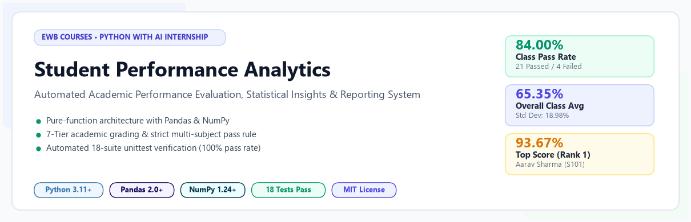
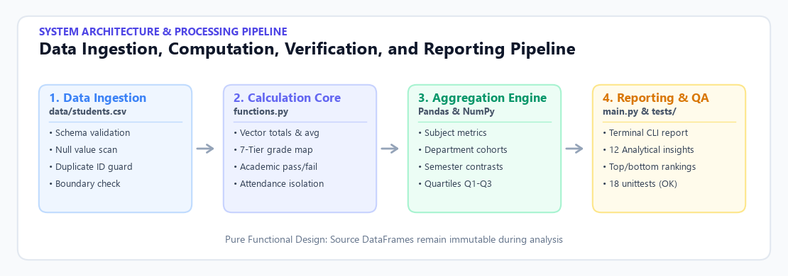
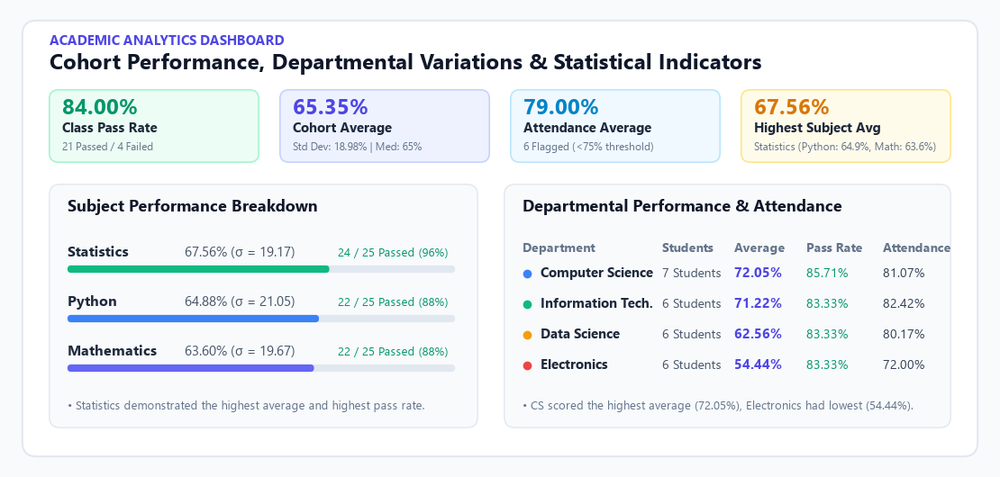
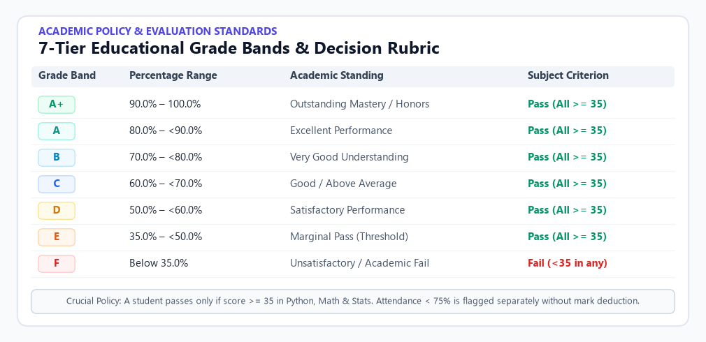
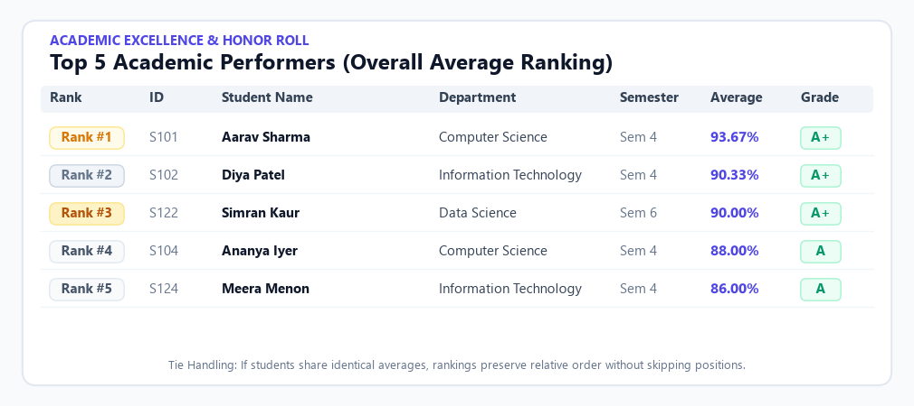
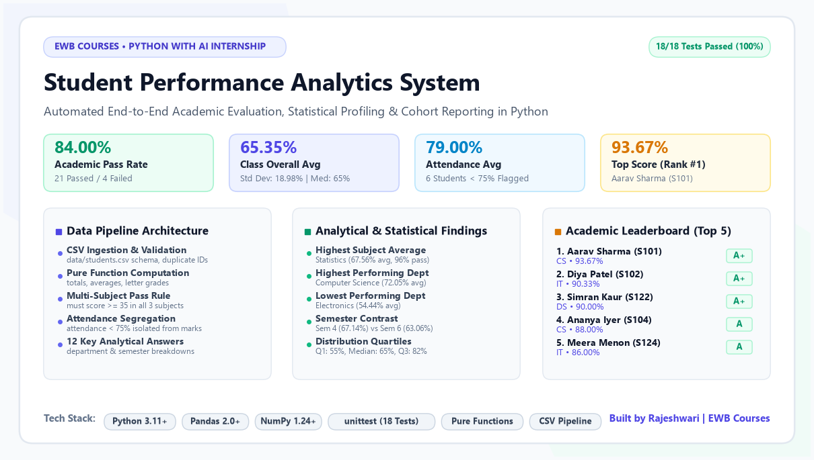

# Student Academic Performance Analytics and Reporting System

<p align="center">
  
</p>

<p align="center">
  <a href="https://www.python.org/downloads/"></a>
  <a href="https://pandas.pydata.org/"></a>
  <a href="https://numpy.org/"></a>
  <a href="tests/"></a>
  <a href="LICENSE"></a>
  <a href="#-author--credits"></a>
</p>

---

## 📌 Executive Summary

The **Student Academic Performance Analytics and Reporting System** is an end-to-end command-line analytical platform developed for academic institutions. Engineered strictly with **Python**, **Pandas**, and **NumPy**, it automates the ingestion, data quality auditing, statistical evaluation, 7-tier letter grading, cohort ranking, and multi-dimensional reporting of student academic performance.

Developed in compliance with the **EWB Courses – Python with AI Project Guidelines**.

> **Course**: EWB Courses | Python with AI Internship Mini-Project  
> **Key Benchmark**: 25 Synthetic Student Records | 18 Automated Unit Tests (100% Pass Rate) | Strict Pure-Function Design

---

## 📊 Key Highlights & Metrics

| 👥 Cohort Size | 🏆 Top Score | 📈 Pass Rate | ⏱️ Avg Attendance | 🧪 Test Suite |
| :---: | :---: | :---: | :---: | :---: |
| **25 Students** | **93.67%** (Aarav Sharma) | **84.00%** (21 Pass / 4 Fail) | **79.00%** (6 Below 75%) | **18 / 18 Passing (100%)** |

---

## 🏛️ System Architecture & Data Pipeline

The application adheres to a modular, pure-functional pipeline where analytical transformations never mutate source dataframes:

<p align="center">
  
</p>

### Pipeline Breakdown
1. **Data Ingestion & Integrity Auditing (`functions.py: load_student_data`)**:
   - Validates CSV file presence and non-emptiness.
   - Enforces 8 mandatory columns and validates data types.
   - Detects nulls, blank strings, duplicate student IDs, and out-of-range numerical values.
2. **Analytical Computation Engine (`functions.py: calculate_student_results`)**:
   - Computes total marks ($Python + Math + Stats$) and percentage averages.
   - Applies the 7-tier letter grading scale (`A+` down to `F`).
   - Enforces the strict multi-subject pass rule ($\ge 35$ across all subjects).
   - Isolates attendance flags ($< 75\%$) without modifying academic scores.
3. **Statistical Aggregation Core (`functions.py`)**:
   - Calculates mean, standard deviation, min, max, and pass rates per subject using NumPy and Pandas.
   - Groups cohort performance across academic departments and semesters.
   - Computes distribution quartiles ($Q_1, Q_2, Q_3$) and interquartile ranges.
4. **Interactive CLI Reporting & Quality Assurance (`main.py` & `tests/`)**:
   - Prints structured reports answering 12 institutional analytical questions.
   - Comprehensive test suite covering edge cases, ties, and data violations.

---

## 📈 Analytical Overview & Cohort Performance

<p align="center">
  
</p>

### Key Analytical Takeaways:
- **Statistics** achieved the highest subject average (**67.56%**) and highest pass percentage (**96.0%**).
- **Computer Science** led departmental rankings with a **72.05%** overall average and an **85.71%** pass rate.
- **Electronics** recorded the lowest departmental average (**54.44%**), identifying a targeted focus area for curriculum support.
- **Semester 4** outperformed **Semester 6** (**67.14%** vs **63.06%**).

---

## 📜 Academic Evaluation & Grading Rubric

The project implements a standardized 7-tier academic grading policy:

<p align="center">
  
</p>

### Grading Policies
- **Academic Pass / Fail Rule**: A student must achieve $\ge 35.0$ in **all three subjects** to receive an overall **Pass**. Scoring $< 35.0$ in even one subject yields an overall **Fail**.
- **Attendance Isolation**: Minimum attendance requirement is **75.0%**. Students below 75% are flagged separately for administrative intervention and their academic marks remain unaltered.

---

## 🏆 Honor Roll & Top Performers

Deterministic ranking identifies the top 5 academic performers across the cohort:

<p align="center">
  
</p>

| Rank | Student ID | Name | Department | Semester | Average | Grade | Attendance |
| :---: | :---: | :--- | :--- | :---: | :---: | :---: | :---: |
| **🥇 #1** | `S101` | **Aarav Sharma** | Computer Science | 4 | **93.67%** | `A+` | 92.5% |
| **🥈 #2** | `S102` | **Diya Patel** | Information Technology | 4 | **90.33%** | `A+` | 88.0% |
| **🥉 #3** | `S122` | **Simran Kaur** | Data Science | 6 | **90.00%** | `A+` | 89.0% |
| **4** | `S104` | **Ananya Iyer** | Computer Science | 4 | **88.00%** | `A` | 94.0% |
| **5** | `S124` | **Meera Menon** | Information Technology | 4 | **86.00%** | `A` | 96.0% |

---

## 🖥️ Terminal Execution & Output Verification

Captured live execution screenshots illustrating terminal output and data verification:

### 1. Data Loading & Schema Inspection
<p align="center">
  
</p>

### 2. Computed Student Results Table
<p align="center">
  
</p>

### 3. Subject-Wise & Departmental Analytics
<p align="center">
  
</p>

### 4. Attendance & 12 Key Analytical Answers
<p align="center">
  
</p>

### 5. Automated Unit Test Verification
<p align="center">
  
</p>

---

## 🎯 Answers to the 12 Analytical Questions

The system autonomously evaluates and reports the answers to 12 institutional questions:

1. **Highest Performing Student**: **Aarav Sharma** (`S101`) with **93.67%** (Grade `A+`).
2. **Subject with Highest Class Average**: **Statistics** (**67.56%**), compared to Python (64.88%) and Mathematics (63.60%).
3. **Students Passing All Three Subjects**: **21 students** (84.00%).
4. **Students Failing At Least One Subject**: **4 students** (16.00% - `S115`, `S116`, `S117`, `S118`).
5. **Overall Class Average**: **65.35%** (Std Dev: 18.98%, Median: 65.00%).
6. **Class Average Attendance**: **79.00%** (Min: 58.00%, Max: 96.00%).
7. **Students with Attendance Below 75%**: **6 students** (`S118`, `S119`, `S120`, `S121`, `S123`, `S125`).
8. **Top 5 Students**:
   1. Aarav Sharma (`S101`) – CS – 93.67% (`A+`)
   2. Diya Patel (`S102`) – IT – 90.33% (`A+`)
   3. Simran Kaur (`S122`) – DS – 90.00% (`A+`)
   4. Ananya Iyer (`S104`) – CS – 88.00% (`A`)
   5. Meera Menon (`S124`) – IT – 86.00% (`A`)
9. **Lowest Performing Student**: **Riya Banerjee** (`S118`) with **26.00%** (Grade `F`).
10. **Class Academic Pass Percentage**: **84.00%**.
11. **Performance Variation Across Departments & Semesters**:
    - Highest Department: **Computer Science** (72.05% avg, 85.71% pass rate)
    - Lowest Department: **Electronics** (54.44% avg, 83.33% pass rate)
    - Semester 4 (67.14% avg) outperformed Semester 6 (63.06% avg).
12. **Distribution Insights**:
    - $Q_1$ (25th Percentile): 55.00%
    - $Q_2$ (50th Percentile / Median): 65.00%
    - $Q_3$ (75th Percentile): 82.00%
    - Interquartile Range ($IQR$): 27.00%
    - Demonstrates a balanced bell curve distribution with high achievers at $\ge 90\%$ and actionable remediation needs for failing students.

---

## 💼 LinkedIn Showcase Asset

A complete LinkedIn post showcase graphic summarizing the full project is generated at the project root as [`image.png`](image.png):

<p align="center">
  
</p>

---

## 🛠️ Installation and Setup

### Prerequisites
- Python 3.10+ installed on your system.

### 1. Clone the Repository
```bash
git clone https://github.com/rajeshwari229080/python-with-ai-internship-mini-project.git
cd python-with-ai-internship-mini-project
```

### 2. Create and Activate Virtual Environment
```powershell
python -m venv .venv
.venv\Scripts\activate
```

### 3. Install Dependencies
```powershell
python -m pip install -r requirements.txt
```

---

## 🚀 Execution & Testing

### Run Analytics Application
```powershell
python main.py
```

### Run Automated Unit Tests
```powershell
python -m unittest discover -s tests -v
```

### Regenerate Visual Assets
```powershell
python scripts/build_assets.py
```

---

## 📁 Repository Structure

```text
python-with-ai-internship-mini-project/
│
├── main.py                     # Main application entry point & CLI reporting engine
├── functions.py                # Pure calculation functions, aggregations & validation
├── requirements.txt            # Project dependencies (pandas, numpy, matplotlib)
├── LICENSE                     # MIT Open Source License
├── .gitignore                  # Git exclusions for Python cache and environments
├── image.png                   # LinkedIn project showcase graphic
│
├── data/
│   └── students.csv            # Synthetic educational dataset (25 records)
│
├── tests/
│   └── test_functions.py       # Automated test suite (18 unit tests, 100% pass)
│
├── assets/                     # Light-theme graphic cards and diagrams
│   ├── banner_light.png        # Project banner card
│   ├── architecture_light.png  # Pipeline architecture diagram
│   ├── analytics_overview.png  # Performance & departmental dashboard
│   ├── grading_rubric_light.png# 7-Tier grading decision matrix
│   ├── top_performers_light.png# Top 5 academic leaderboard
│   └── linkedin_showcase.png   # LinkedIn showcase image backup
│
├── screenshots/                # Real terminal execution screenshots
│   ├── 01_dataset_inspection.png
│   ├── 02_student_results_table.png
│   ├── 03_subject_department_analysis.png
│   ├── 04_attendance_and_key_answers.png
│   ├── 05_unit_tests.png
│   └── README.md
│
├── scripts/
│   └── build_assets.py         # Matplotlib asset generation pipeline
│
└── Project_Documentation.md    # 10-section academic documentation
```

---

## 🧪 Unit Test Suite (18 Tests)

The test suite in [`tests/test_functions.py`](tests/test_functions.py) rigorously validates all edge cases:

- [x] Grade boundary checks (35, 50, 60, 70, 80, 90, 100) and out-of-range rejections.
- [x] Multi-subject pass requirement (failing 1 subject fails overall status).
- [x] Accuracy of totals, averages, and attendance threshold evaluations.
- [x] Mathematical calculations for mean, standard deviation, and pass rates.
- [x] Tie-handling logic preserving deterministic student ranks.
- [x] CSV error handling: missing file, empty dataset, missing columns, duplicate IDs, negative marks, attendance $> 100$.

```text
Ran 18 tests in 0.153s

OK
```

---

## 📋 GitHub Submission Checklist

- [x] Python scripts [`main.py`](main.py) and [`functions.py`](functions.py) committed.
- [x] Dataset [`data/students.csv`](data/students.csv) contains 25 valid student records.
- [x] All 18 unit tests in [`tests/test_functions.py`](tests/test_functions.py) passing.
- [x] Dependencies specified in [`requirements.txt`](requirements.txt).
- [x] Comprehensive [`.gitignore`](.gitignore) configured.
- [x] Open-source [`LICENSE`](LICENSE) (MIT) added.
- [x] Light-theme visual assets created in [`assets/`](assets/).
- [x] Full LinkedIn project showcase graphic generated as [`image.png`](image.png).
- [x] Formal academic [`Project_Documentation.md`](Project_Documentation.md) prepared.

---

## 👤 Author & Credits

- **Developer:** Rajeshwari
- **Programme:** EWB Courses – Python with AI Internship
- **Repository:** [`rajeshwari229080/python-with-ai-internship-mini-project`](https://github.com/rajeshwari229080/python-with-ai-internship-mini-project)

---

## 📄 License

This project is licensed under the **MIT License** - see the [LICENSE](LICENSE) file for details.
